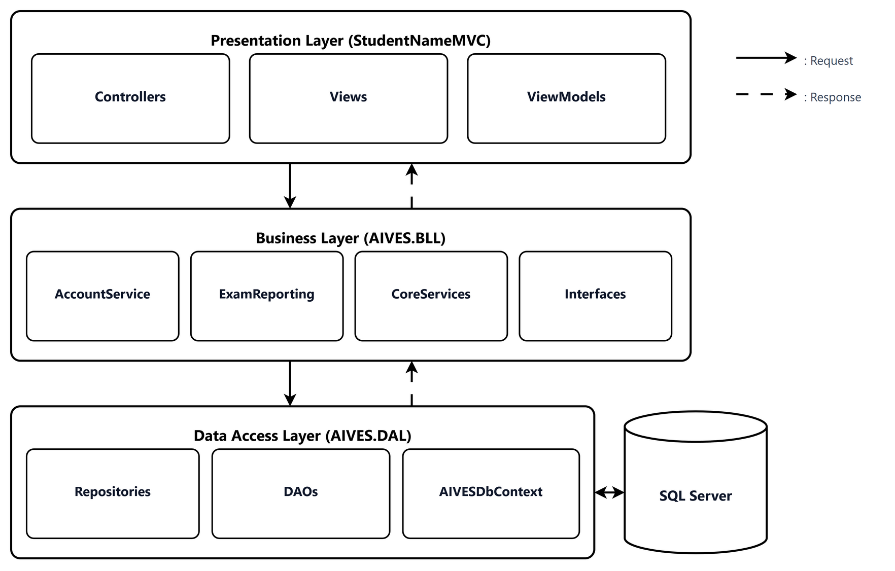

# AIVES — AI-powered Viva Examination System

Hệ thống thi vấn đáp (viva) có AI hỗ trợ, xây dựng trên ASP.NET Core 8 theo kiến trúc 3 lớp.
Assignment 3 tập trung vào **Group 4 — AI-Assisted Viva Grading with Human-in-the-Loop (HITL)**.

---

## Kiến trúc 3 lớp



| Layer | Project | Trách nhiệm |
| :--- | :--- | :--- |
| Presentation | `StudentNameMVC` | MVC Controllers, Razor Pages (`/Viva`, `/Grading`, `/Reports`), ViewModels, SignalR Hubs, static assets |
| Business Logic | `AIVES.BLL` | Orchestration (`IGradingOrchestrator`, `VivaSessionOrchestrator`), business rules, AI abstractions, background services |
| Data Access | `AIVES.DAL` | Entities, `AIVESDbContext` (EF Core 8), Scoped Repositories |

**Luồng phụ thuộc:** `Presentation → BLL → DAL → SQL Server`.
Presentation không bao giờ tham chiếu `AIVESDbContext` hay Repository trực tiếp.

Sơ đồ nguồn (mở/sửa bằng [draw.io](https://app.diagrams.net)): [`AIVES_Architecture.drawio`](AIVES_Architecture.drawio)
· Tổng quan kiến trúc: [`docs/ARCHITECTURE.md`](docs/ARCHITECTURE.md)

---

## Chức năng chính

- **Viva room tương tác** — ghi âm WebAudio, STT/TTS, câu hỏi đào sâu, đồng bộ realtime qua SignalR.
- **Chấm điểm AI bất đồng bộ** — hàng đợi `System.Threading.Channels` + `VivaGradingBackgroundService`, chấm từng câu độc lập.
- **Human-in-the-Loop** — giảng viên xác nhận điểm AI hoặc nhập điểm riêng; mọi thay đổi điểm đã chốt đều ghi audit (`VivaGradeChangeLogs`).
- **Rubric trong database** — tiêu chí chấm lưu ở `VivaRubricCriteria` thay cho catalog hard-code.
- **Fault isolation** — AI lỗi/timeout ở một câu sẽ fallback sang chấm theo từ khóa, không làm hỏng cả bài.
- **Báo cáo** — báo cáo sinh viên, báo cáo lớp, badge trạng thái `AI chấm, chờ giảng viên duyệt` → `Điểm chính thức`.

---

## Công nghệ

.NET 8 · ASP.NET Core MVC + Razor Pages · Entity Framework Core 8 · SQL Server · SignalR · xUnit + Playwright

---

## Build & chạy

```bash
dotnet build AIVESSystem.sln
dotnet run --project StudentNameMVC/StudentNameMVC.csproj
```

Chạy test:

```bash
dotnet test AIVESSystem.sln                          # toàn bộ
dotnet test AIVES.Tests/AIVES.Tests.csproj            # unit / integration
dotnet test AIVES.E2E/AIVES.E2E.csproj                # Playwright E2E
```

Database: chạy lần lượt các script trong `database/` (001 → 006) trước khi khởi động ứng dụng.

---

## Màn hình chính

| Route | Mô tả |
| :--- | :--- |
| `/` | Trang chủ |
| `/Account/Login` | Đăng nhập |
| `/Viva/Exam/{sessionId}` | Phòng thi vấn đáp tương tác |
| `/Grading/Index` | Giảng viên — danh sách bài chờ duyệt điểm |
| `/Grading/Review/{sessionId}` | Giảng viên — duyệt điểm, override, xem audit log |
| `/Reports/Student` | Báo cáo điểm & nhận xét rubric của sinh viên |
| `/Reports/Class` | Báo cáo tổng hợp theo lớp |

---

## Tài liệu

- [`AGENTS.md`](AGENTS.md) — quy ước làm việc nhóm, phân chia module, ràng buộc kiến trúc
- [`docs/G4-CONTRACTS.md`](docs/G4-CONTRACTS.md) — contract & sự kiện dùng chung (Group 4)
- [`docs/G4-TASK-BOARD.md`](docs/G4-TASK-BOARD.md) — bảng công việc Group 4
- [`docs/ARCHITECTURE.md`](docs/ARCHITECTURE.md) — tổng quan kiến trúc nền
- [`docs/CODE-REVIEW-CHECKLIST.md`](docs/CODE-REVIEW-CHECKLIST.md) — checklist review code
