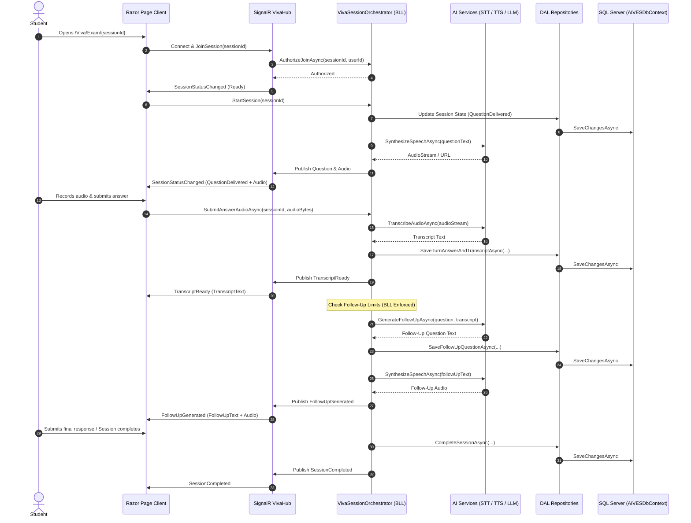

# AIVES Assignment 2 — Shared Architecture & Integration Contracts
## Functional Group 3: AI Interview Core

> **Status:** Official Approved Specification (Assignment 2)  
> **Author:** Tech Lead & Architecture Planning Agent  
> **Target Audience:** All 5 Team Members (Tech Lead, Razor Pages Frontend, SignalR Realtime, Database & Repositories, AI Integration)  
> **Applicable Stack:** ASP.NET Core .NET 8, Razor Pages, SignalR Realtime, 3-Layer Architecture (Presentation → BLL → DAL), EF Core, SQL Server  

---

## 1. Executive Overview & Workflow

The goal of **Functional Group 3 (AI Interview Core)** in AIVES Assignment 2 is to deliver an automated, interactive Viva Examination session where:
1. Student accesses a dedicated **Razor Pages** interview room (`/Viva/Exam/{sessionId}`).
2. The session starts and loads the primary viva question.
3. **TTS (Text-to-Speech)** synthesizes audio for the question so the student can listen.
4. The student records their spoken response using their microphone.
5. Audio is submitted and processed via **STT (Speech-to-Text)** to produce a text transcript.
6. The transcript is persisted in the database and broadcasted in realtime to the client via **SignalR**.
7. An **AI LLM service** analyzes the transcript against the question and generates a contextual **Follow-Up Question**.
8. The follow-up question is persisted, and **SignalR** notifies the client to display and read it aloud via TTS.
9. Upon answering the follow-up (or reaching session limits), the session completes and saves the entire turn history for subsequent reporting (Group 6).



---

## 2. Session Identifiers & State Machine

### 2.1 Identifiers
* `SessionId` (`Guid`): Unique identifier for a single viva exam attempt.
* `ExamId` (`string`, max 50 chars): Code of the exam subject/test (e.g., `"EXAM01"`).
* `StudentId` (`string`, max 50 chars): Student identifier (matches authenticated User Id / Claim).
* `QuestionId` (`string`, max 50 chars): Unique identifier of the question item.
* `TurnId` (`Guid`): Identifier for a specific interaction turn (Main Question + Student Answer + Follow-Up).

### 2.2 Session States (`VivaSessionState`)
```csharp
namespace AIVES.BLL.Models.VivaInterview;

public enum VivaSessionState : byte
{
    Created = 0,             // Session record created, awaiting student entry
    Ready = 1,               // Student connected to room and verified
    QuestionDelivered = 2,   // Main question displayed and TTS played
    Answering = 3,           // Microphone recording active / Timer ticking
    Transcribing = 4,        // Audio uploaded, STT processing in progress
    TranscriptReady = 5,     // Transcript parsed and persisted
    FollowUpGenerating = 6,  // LLM analyzing response to synthesize follow-up
    FollowUpDelivered = 7,   // Follow-up question displayed and TTS played
    Completed = 8,           // All turns completed, results persisted
    Failed = 9,              // Fatal error encountered
    TimedOut = 10            // Session or turn timed out
}
```

### 2.3 Allowed State Transitions
| From State | Allowed Target State | Trigger / Event |
| :--- | :--- | :--- |
| `Created` | `Ready` | Student successfully connects to SignalR room. |
| `Ready` | `QuestionDelivered` | Student clicks "Start Exam" or automated countdown triggers question. |
| `QuestionDelivered` | `Answering` | Question TTS completes; student microphone activates. |
| `Answering` | `Transcribing` | Student stops recording and uploads audio payload. |
| `Answering` | `TimedOut` | Answering time limit exceeded without student audio. |
| `Transcribing` | `TranscriptReady` | STT returns valid text and BLL persists transcript. |
| `Transcribing` | `Failed` | STT service unrecoverable failure. |
| `TranscriptReady` | `FollowUpGenerating` | Turn count < MaxFollowUps; BLL initiates LLM prompt. |
| `TranscriptReady` | `Completed` | Turn count >= MaxFollowUps or last question concluded. |
| `FollowUpGenerating` | `FollowUpDelivered` | LLM returns question; BLL persists follow-up and TTS audio. |
| `FollowUpGenerating` | `Completed` | LLM decides student answer was exhaustive or max follow-up reached. |
| `FollowUpDelivered` | `Answering` | Student begins answering the follow-up question. |
| Any State | `Failed` | Fatal exception or unhandled disconnect timeout. |

---

## 3. Data Transfer Objects (DTOs)

All DTOs reside in `AIVES.BLL.Models.VivaInterview`:

```csharp
namespace AIVES.BLL.Models.VivaInterview;

public sealed record VivaQuestionDto(
    string QuestionId,
    string ExamId,
    string Title,
    string Content,
    int TimeLimitSeconds,
    string? AudioUrl = null
);

public sealed record VivaAnswerSubmissionDto(
    Guid SessionId,
    string QuestionId,
    byte[] AudioData,
    string ContentType, // e.g. "audio/webm" or "audio/wav"
    int DurationSeconds
);

public sealed record VivaTranscriptDto(
    Guid SessionId,
    Guid TurnId,
    string QuestionId,
    string TranscriptText,
    decimal ConfidenceScore,
    DateTime CompletedAtUtc
);

public sealed record VivaFollowUpDto(
    Guid SessionId,
    Guid TurnId,
    string FollowUpQuestionId,
    string FollowUpContent,
    int FollowUpOrdinal, // 1 for first follow-up, 2 for second, etc.
    string? AudioUrl = null
);

public sealed record VivaSessionStatusDto(
    Guid SessionId,
    string ExamId,
    string StudentId,
    VivaSessionState State,
    int CurrentTurnOrdinal,
    int MaxTurnsAllowed,
    DateTime UpdatedAtUtc,
    string? Message = null
);

public sealed record VivaTimeRemainingDto(
    Guid SessionId,
    int SecondsRemaining,
    int TotalSecondsAllowed
);

public sealed record VivaErrorDto(
    Guid SessionId,
    string ErrorCode,
    string ErrorMessage,
    bool CanRetry
);
```

---

## 4. SignalR Hub Event Contracts

### 4.1 Hub Information
* **Hub Route:** `/hubs/viva`
* **Hub Class Name:** `AIVES.Presentation.Hubs.VivaHub` (located in `StudentNameMVC/Hubs/VivaHub.cs`).
* **Hub Group Naming:** `viva-session-{sessionId:D}` (e.g. `viva-session-a1b2c3d4-e5f6-7890-abcd-ef1234567890`).

### 4.2 Approved Event Names
The client listens to the following strictly enforced event strings:
1. `SessionStatusChanged`
2. `TranscriptReady`
3. `FollowUpGenerated`
4. `TimeRemainingChanged`
5. `SessionCompleted`
6. `VivaError`

### 4.3 Event Payloads (JSON Specifications)

#### 1. `SessionStatusChanged`
Broadcasted whenever the session advances states (e.g. `QuestionDelivered`, `Answering`).
```json
{
  "sessionId": "b47e2213-9f8a-45c2-9e8c-8c7a840e6912",
  "examId": "EXAM01",
  "studentId": "SV01",
  "state": "QuestionDelivered",
  "currentTurnOrdinal": 1,
  "maxTurnsAllowed": 2,
  "updatedAtUtc": "2026-10-12T09:30:00Z",
  "message": "Question 1 delivered. Listening to TTS."
}
```

#### 2. `TranscriptReady`
Broadcasted after audio submission is successfully transcribed by STT and persisted.
```json
{
  "sessionId": "b47e2213-9f8a-45c2-9e8c-8c7a840e6912",
  "turnId": "c58f3324-1a9b-46d3-af9d-9d8b951f7023",
  "questionId": "Q1",
  "transcriptText": "DbContext has a Scoped lifetime and is instantiated once per HTTP request.",
  "confidenceScore": 0.94,
  "completedAtUtc": "2026-10-12T09:31:15Z"
}
```

#### 3. `FollowUpGenerated`
Broadcasted when AI LLM generates a targeted follow-up question and its TTS audio is ready.
```json
{
  "sessionId": "b47e2213-9f8a-45c2-9e8c-8c7a840e6912",
  "turnId": "c58f3324-1a9b-46d3-af9d-9d8b951f7023",
  "followUpQuestionId": "Q1-FU1",
  "followUpContent": "AI Examiner asks: Why would holding a Scoped DbContext inside a Singleton DAO cause multi-threading exceptions?",
  "followUpOrdinal": 1,
  "audioUrl": "/audio/cache/q1-fu1.mp3"
}
```

#### 4. `TimeRemainingChanged`
Published periodically (e.g. every second) during active recording.
```json
{
  "sessionId": "b47e2213-9f8a-45c2-9e8c-8c7a840e6912",
  "secondsRemaining": 45,
  "totalSecondsAllowed": 90
}
```

#### 5. `SessionCompleted`
Broadcasted when all viva questions and follow-ups have completed.
```json
{
  "sessionId": "b47e2213-9f8a-45c2-9e8c-8c7a840e6912",
  "studentId": "SV01",
  "examId": "EXAM01",
  "totalTurns": 2,
  "completedAtUtc": "2026-10-12T09:35:00Z",
  "redirectUrl": "/StudentReports/AttemptDetails?attemptId=ATT-001"
}
```

#### 6. `VivaError`
Broadcasted when an operation encounters a recoverable or unrecoverable error.
```json
{
  "sessionId": "b47e2213-9f8a-45c2-9e8c-8c7a840e6912",
  "errorCode": "STT_PROCESSING_FAILED",
  "errorMessage": "Audio quality was unclear. Please re-record your answer.",
  "canRetry": true
}
```

---

## 5. Service & Repository Interface Contracts

### 5.1 Business Logic Orchestrator (`IVivaSessionOrchestrator`)
Located in `AIVES.BLL.Interfaces.VivaInterview`:
```csharp
namespace AIVES.BLL.Interfaces.VivaInterview;

public interface IVivaSessionOrchestrator
{
    Task<VivaSessionStatusDto> InitializeSessionAsync(string examId, string studentId, CancellationToken ct = default);
    Task<bool> AuthorizeUserForSessionAsync(Guid sessionId, string userId, CancellationToken ct = default);
    Task<VivaQuestionDto> StartSessionAsync(Guid sessionId, CancellationToken ct = default);
    Task<VivaTranscriptDto> SubmitAnswerAudioAsync(VivaAnswerSubmissionDto submission, CancellationToken ct = default);
    Task<VivaFollowUpDto?> GenerateFollowUpAsync(Guid sessionId, Guid turnId, CancellationToken ct = default);
    Task<VivaSessionStatusDto> CompleteSessionAsync(Guid sessionId, CancellationToken ct = default);
}
```

### 5.2 Realtime Event Publisher Abstraction (`IVivaRealtimePublisher`)
BLL Services never inject `IHubContext` directly; they publish via this abstraction to decouple BLL from ASP.NET Core presentation transport:
```csharp
namespace AIVES.BLL.Interfaces.VivaInterview;

public interface IVivaRealtimePublisher
{
    Task PublishStatusChangedAsync(VivaSessionStatusDto status, CancellationToken ct = default);
    Task PublishTranscriptReadyAsync(VivaTranscriptDto transcript, CancellationToken ct = default);
    Task PublishFollowUpGeneratedAsync(VivaFollowUpDto followUp, CancellationToken ct = default);
    Task PublishTimeRemainingAsync(VivaTimeRemainingDto timer, CancellationToken ct = default);
    Task PublishSessionCompletedAsync(Guid sessionId, string examId, string studentId, CancellationToken ct = default);
    Task PublishErrorAsync(VivaErrorDto error, CancellationToken ct = default);
}
```

### 5.3 DAL Repository Interface Contracts
Located in `AIVES.DAL.Repositories.Interfaces`:
```csharp
namespace AIVES.DAL.Repositories.Interfaces;

public interface IVivaSessionRepository
{
    Task<VivaSession?> GetByIdAsync(Guid sessionId, CancellationToken ct = default);
    Task<VivaSession?> GetWithDetailsAsync(Guid sessionId, CancellationToken ct = default);
    Task<Guid> CreateSessionAsync(VivaSession session, CancellationToken ct = default);
    Task UpdateStateAsync(Guid sessionId, byte state, CancellationToken ct = default);
    Task CompleteSessionAsync(Guid sessionId, DateTime completedAtUtc, CancellationToken ct = default);
}

public interface IVivaQuestionRepository
{
    Task<List<VivaQuestion>> GetQuestionsByExamAsync(string examId, CancellationToken ct = default);
    Task<VivaQuestion?> GetByIdAsync(string questionId, CancellationToken ct = default);
}

public interface IVivaTurnRepository
{
    Task<Guid> CreateTurnAsync(VivaSessionTurn turn, CancellationToken ct = default);
    Task<VivaSessionTurn?> GetByIdAsync(Guid turnId, CancellationToken ct = default);
    Task SaveTranscriptAsync(Guid turnId, string transcript, decimal confidence, CancellationToken ct = default);
    Task SaveFollowUpAsync(Guid turnId, string followUpQuestion, string? audioPath, CancellationToken ct = default);
    Task<int> GetTurnCountForSessionAsync(Guid sessionId, CancellationToken ct = default);
}
```

---

## 6. AI Provider Interface Contracts

Located in `AIVES.BLL.Interfaces.Ai`:

```csharp
namespace AIVES.BLL.Interfaces.Ai;

public interface ISpeechToTextService
{
    Task<SpeechToTextResult> TranscribeAsync(Stream audioStream, string contentType, CancellationToken ct = default);
}

public sealed record SpeechToTextResult(
    bool IsSuccess,
    string TranscriptText,
    decimal ConfidenceScore,
    string? ErrorMessage = null
);

public interface ITextToSpeechService
{
    Task<TextToSpeechResult> SynthesizeAsync(string text, string voiceLocale = "vi-VN", CancellationToken ct = default);
}

public sealed record TextToSpeechResult(
    bool IsSuccess,
    string? AudioUrl,
    byte[]? AudioData,
    string? ErrorMessage = null
);

public interface IFollowUpGeneratorService
{
    Task<FollowUpResult> GenerateFollowUpQuestionAsync(
        string originalQuestion,
        string studentAnswerTranscript,
        string subjectContext,
        CancellationToken ct = default);
}

public sealed record FollowUpResult(
    bool IsSuccess,
    string FollowUpQuestionText,
    string CognitiveIntent, // e.g. "Clarification", "Deep-Dive", "Edge-Case"
    string? ErrorMessage = null
);
```

---

## 7. Business Logic Limits & Safeguards (BLL Enforced)

1. **Follow-Up Count Limit:**
   * A viva turn allows **maximum 1 or 2 follow-ups** per primary question.
   * The LLM service is an advisory generation engine; the `VivaSessionOrchestrator` in BLL checks `turnCount < maxFollowUpsAllowed`. If the limit is reached, BLL marks the turn completed and advances to the next question or completes the exam. The AI cannot bypass this rule.
2. **Persistence First Rule:**
   * All state changes, audio file paths, transcripts, and follow-up text **MUST be committed to SQL Server via `SaveChangesAsync` before SignalR triggers broadcasts**.
   * If database persistence fails, no SignalR event is broadcast to avoid client state desynchronization.
3. **No Group 4 AI Scoring in Assignment 2:**
   * In Assignment 2, the AI only generates follow-up questions (`IFollowUpGeneratorService`). No scoring, grade assignment, or rubric evaluation is calculated in Group 3.
4. **Group Authorization Rule:**
   * When a client invokes `JoinSession(sessionId)` on `VivaHub`, the Hub validates that `Context.UserIdentifier == session.StudentId` or that the user has a Lecturer/Admin role. If unauthorized, the connection is aborted with `HubException("Unauthorized session access")`.
5. **Rate Limiting & Audio Validation:**
   * Audio submissions must not exceed 25MB and duration must be within the configured question time limit (e.g., 180 seconds).

---

## 8. Summary of Responsibilities by Sub-Team

| Role | Sub-Team Member | Primary Deliverables | Out of Scope |
| :--- | :--- | :--- | :--- |
| **Tech Lead** | Member 1 (Lead) | `IVivaSessionOrchestrator`, Shared Contracts, DI Registration, E2E Integration, PR Review | Direct UI implementation, raw AI adapter code |
| **Frontend** | Member 2 | Razor Pages (`/Viva/Exam`), WebAudio Recorder, SignalR client JS, TTS Audio Player | Direct DB queries, LLM prompting |
| **SignalR** | Member 3 | `VivaHub`, `IVivaRealtimePublisher` implementation, Session group authorization, Reconnect resilience | Direct EF Core persistence, UI styling |
| **Database** | Member 4 | `VivaSession`, `VivaQuestion`, `VivaSessionTurn` entities, EF Core configurations, Repositories | Direct SignalR broadcasting, AI HTTP calls |
| **AI Integration** | Member 5 | `ISpeechToTextService`, `ITextToSpeechService`, `IFollowUpGeneratorService` + Mock/Adapters | Business policy decisions, Scoring logic |
