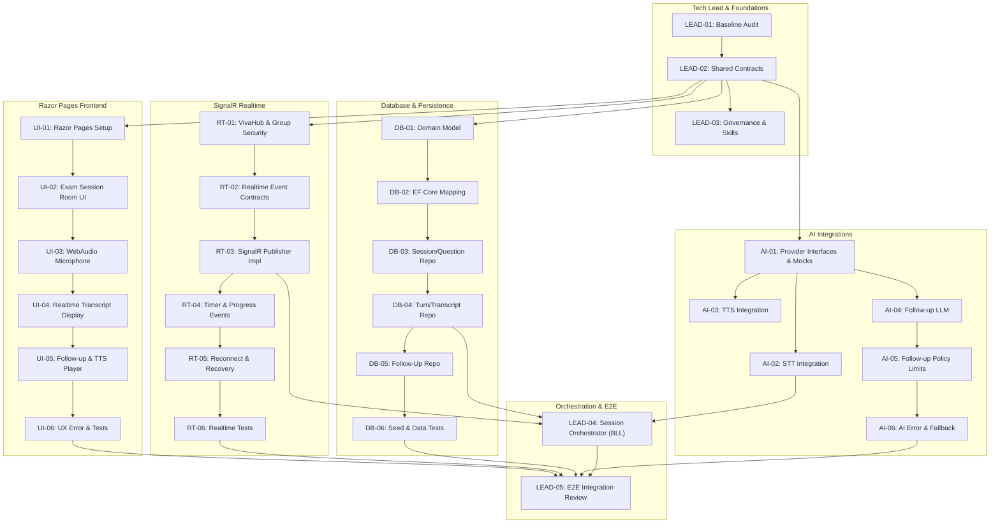

# AIVES Assignment 2 — Team Task Board & GitHub Issue Plan
## Functional Group 3: AI Interview Core

> **Status:** Official Approved Task Board (29 Issues)  
> **Author:** Tech Lead & Architecture Planning Agent  
> **Team Structure:** 1 Tech Lead/Reviewer + 4 Domain Developers (Frontend, SignalR, Database, AI)  
> **Target Release:** Assignment 2 Deliverable  

---

## Task Board Summary Matrix

| Role | Member | Assigned Issues | Focus Area |
| :--- | :--- | :--- | :--- |
| **Tech Lead** | Member 1 (Lead) | `LEAD-01` to `LEAD-05` (5 issues) | Architecture, Contracts, Governance, Orchestration, Review |
| **Frontend** | Member 2 | `UI-01` to `UI-06` (6 issues) | Razor Pages, WebAudio Microphone, SignalR JS Client, Audio Playback |
| **SignalR** | Member 3 | `RT-01` to `RT-06` (6 issues) | `VivaHub`, Group Authorization, Realtime Event Publisher, Reconnection |
| **Database** | Member 4 | `DB-01` to `DB-06` (6 issues) | EF Core Entities, DbContext Mapping, Repositories, Migrations/Seed |
| **AI Integration** | Member 5 | `AI-01` to `AI-06` (6 issues) | STT, TTS, LLM Follow-Up Adapters, Mocks, Error Handling |
| **Total** | **5 Members** | **29 Issues** | **End-to-End AI Viva Interview Flow** |

---

---

# Section I: Tech Lead (LEAD-01 to LEAD-05)

### LEAD-01: Repository Baseline Audit
* **Objective:** Perform baseline inspection of the repository, solution structure, existing News code, Group 6 code, and verify dependencies before Assignment 2 implementation begins.
* **Scope:** Read-only audit across `StudentNameMVC`, `AIVES.BLL`, `AIVES.DAL`, and `AIVES.Tests`. Document differences between legacy News management and AI Viva domain.
* **Assigned Role:** Tech Lead
* **Dependencies:** None
* **Expected Files/Modules:** `docs/ARCHITECTURE.md`, `docs/ASM2-CONTRACTS.md`
* **Acceptance Criteria:**
  - Complete list of existing project capabilities, reusable components (auth, mock repositories), and architectural gaps documented.
  - Zero modifications to functional C# code.
* **Test Instructions:** Run `dotnet test AIVESSystem.sln` to confirm 89/89 tests pass on baseline.
* **Out-of-Scope:** Modifying solution files, installing packages.
* **Suggested Branch Name:** `kien/asm2-lead-01-baseline-audit`
* **Category:** [MVP]

---

### LEAD-02: Architecture & Integration Contracts
* **Objective:** Define and approve all shared contracts, DTOs, SignalR event names, and repository/AI interfaces in `docs/ASM2-CONTRACTS.md`.
* **Scope:** Standardize data exchange models across Razor Pages, SignalR, BLL, DAL, and AI services.
* **Assigned Role:** Tech Lead
* **Dependencies:** `LEAD-01`
* **Expected Files/Modules:** `docs/ASM2-CONTRACTS.md`
* **Acceptance Criteria:**
  - All 6 SignalR event names (`SessionStatusChanged`, `TranscriptReady`, `FollowUpGenerated`, `TimeRemainingChanged`, `SessionCompleted`, `VivaError`) finalized.
  - State machine transitions defined.
  - C# records and DTO schemas defined with no missing fields.
* **Test Instructions:** Peer review document against Assignment 2 rubric.
* **Out-of-Scope:** Code implementations.
* **Suggested Branch Name:** `kien/asm2-lead-02-contracts`
* **Category:** [MVP]

---

### LEAD-03: Agent Skills & Governance
* **Objective:** Create and update AI Agent skills and governance entrypoint (`AGENTS.md`) to guide autonomous agents and teammates.
* **Scope:** Create `aives-architecture`, `aives-realtime-signalr`, `aives-ai-integration`; update `team-git-workflow` and `AGENTS.md`. Retire `funews-architecture`.
* **Assigned Role:** Tech Lead
* **Dependencies:** `LEAD-02`
* **Expected Files/Modules:** `AGENTS.md`, `.agents/skills/*`
* **Acceptance Criteria:**
  - All skills have valid YAML frontmatter.
  - `AGENTS.md` routes to new skills and enforces 1-issue-1-branch Git rules.
* **Test Instructions:** Validate skill files with markdown linter.
* **Out-of-Scope:** Code changes.
* **Suggested Branch Name:** `kien/asm2-lead-03-skills-governance`
* **Category:** [MVP]

---

### LEAD-04: Viva Session Orchestration
* **Objective:** Implement `IVivaSessionOrchestrator` and `VivaSessionOrchestrator` in `AIVES.BLL` coordinating audio transcription, turn persistence, follow-up generation, and realtime publishing.
* **Scope:** Implement business workflow orchestration. Enforce follow-up count limits (max 1-2 turns) and "persistence-first" rule before broadcasting.
* **Assigned Role:** Tech Lead
* **Dependencies:** `LEAD-02`, `DB-03`, `DB-04`, `RT-03`, `AI-02`, `AI-04`
* **Expected Files/Modules:** `AIVES.BLL/Interfaces/VivaInterview/IVivaSessionOrchestrator.cs`, `AIVES.BLL/Services/VivaInterview/VivaSessionOrchestrator.cs`
* **Acceptance Criteria:**
  - `StartSessionAsync` initializes session and delivers initial question.
  - `SubmitAnswerAudioAsync` calls STT, persists transcript to DAL, and triggers `TranscriptReady`.
  - Follow-up question limit enforced; stops at `maxFollowUps`.
* **Test Instructions:** Unit test in `AIVES.Tests/BLL/VivaSessionOrchestratorTests.cs` using mock repositories and mock AI services.
* **Out-of-Scope:** Direct SignalR Hub calls (use `IVivaRealtimePublisher`).
* **Suggested Branch Name:** `kien/asm2-lead-04-orchestrator`
* **Category:** [MVP]

---

### LEAD-05: Integration & E2E Review
* **Objective:** Review all 4 teammate PRs, register application-wide Dependency Injection in `Program.cs`, and conduct end-to-end verification.
* **Scope:** Wire up `builder.Services.AddRazorPages()`, `builder.Services.AddSignalR()`, Map `/hubs/viva`, register AI adapters and Repositories in DI.
* **Assigned Role:** Tech Lead
* **Dependencies:** `LEAD-04`, `UI-06`, `RT-06`, `DB-06`, `AI-06`
* **Expected Files/Modules:** `StudentNameMVC/Program.cs`, `docs/CODE-REVIEW-CHECKLIST.md`
* **Acceptance Criteria:**
  - Solution builds with 0 warnings, 0 errors.
  - Student can complete full interview flow: Open Exam → Listen to Question → Speak Answer → See Transcript → Receive Follow-up → Complete Session.
  - 100% automated tests pass.
* **Test Instructions:** Run full regression suite `dotnet test AIVESSystem.sln` and execute manual browser test.
* **Out-of-Scope:** Group 4 AI scoring.
* **Suggested Branch Name:** `kien/asm2-lead-05-integration-review`
* **Category:** [MVP]

---

# Section II: Frontend — Razor Pages (UI-01 to UI-06)

### UI-01: Razor Pages Setup
* **Objective:** Set up Razor Pages routing in `StudentNameMVC` alongside existing MVC controllers without conflict.
* **Scope:** Add `Pages/` directory, `_ViewImports.cshtml`, `_ViewStart.cshtml`, and basic page layout styling for viva rooms.
* **Assigned Role:** Razor Pages Frontend
* **Dependencies:** `LEAD-02`
* **Expected Files/Modules:** `StudentNameMVC/Pages/Viva/_ViewImports.cshtml`, `StudentNameMVC/Pages/Viva/_ViewStart.cshtml`, `StudentNameMVC/Pages/Shared/_VivaLayout.cshtml`
* **Acceptance Criteria:**
  - A sample `/Viva/Index` or `/Viva/Test` page renders successfully with responsive CSS.
  - Does not break existing MVC controllers or routes (`/NewsArticle`, `/StudentReports`).
* **Test Instructions:** Request `/Viva/Test` in browser; verify HTTP 200 and shared navigation.
* **Out-of-Scope:** Viva examination interactive logic.
* **Suggested Branch Name:** `member2/asm2-ui-01-razor-pages-setup`
* **Category:** [MVP]

---

### UI-02: Exam Session UI
* **Objective:** Build the interactive viva room Razor Page (`/Viva/Exam/{sessionId}`) displaying exam title, candidate info, question cards, and status indicators.
* **Scope:** `StudentNameMVC/Pages/Viva/Exam.cshtml` and `Exam.cshtml.cs` PageModel.
* **Assigned Role:** Razor Pages Frontend
* **Dependencies:** `UI-01`, `LEAD-02`
* **Expected Files/Modules:** `StudentNameMVC/Pages/Viva/Exam.cshtml`, `StudentNameMVC/Pages/Viva/Exam.cshtml.cs`
* **Acceptance Criteria:**
  - `OnGetAsync(Guid sessionId)` validates user access via BLL service and populates `ExamSessionViewModel`.
  - UI displays Question Title, Question Content, and turn progress badge (e.g., "Question 1 of 3").
  - Unauthorized access redirects to AccessDenied.
* **Test Instructions:** Open `/Viva/Exam/{validGuid}` as logged-in student; verify question card renders.
* **Out-of-Scope:** Realtime audio recording.
* **Suggested Branch Name:** `member2/asm2-ui-02-exam-session-ui`
* **Category:** [MVP]

---

### UI-03: Microphone Recording (WebAudio API)
* **Objective:** Implement client-side JavaScript microphone audio recorder using HTML5 `MediaRecorder` / WebAudio API.
* **Scope:** Create `wwwroot/js/viva-audio-recorder.js`. Handle microphone permissions, recording start/stop, visual soundwave indicator, and blob extraction.
* **Assigned Role:** Razor Pages Frontend
* **Dependencies:** `UI-02`
* **Expected Files/Modules:** `StudentNameMVC/wwwroot/js/viva-audio-recorder.js`
* **Acceptance Criteria:**
  - Record button starts recording; displays animated recording state and countdown timer.
  - Stop button exports valid `audio/webm` or `audio/wav` blob.
  - Gracefully alerts user if microphone access is denied by browser.
* **Test Instructions:** Manual browser test with microphone; verify recorded audio blob plays back.
* **Out-of-Scope:** Uploading to backend (handled in UI-04).
* **Suggested Branch Name:** `member2/asm2-ui-03-microphone`
* **Category:** [MVP]

---

### UI-04: Realtime Transcript UI
* **Objective:** Connect Razor Page to SignalR `VivaHub` and render spoken transcripts dynamically when `TranscriptReady` fires.
* **Scope:** Create `wwwroot/js/viva-signalr-client.js`. Upload audio blob via AJAX/fetch to PageModel handler, show loading spinner ("AI is transcribing..."), and append transcript text on `TranscriptReady`.
* **Assigned Role:** Razor Pages Frontend
* **Dependencies:** `UI-03`, `RT-01`, `RT-02`
* **Expected Files/Modules:** `StudentNameMVC/wwwroot/js/viva-signalr-client.js`, `StudentNameMVC/Pages/Viva/Exam.cshtml`
* **Acceptance Criteria:**
  - Client establishes SignalR connection to `/hubs/viva` and joins session group.
  - Upon receiving `TranscriptReady`, transcript box updates in realtime without full-page refresh.
* **Test Instructions:** Simulate STT event; verify DOM updates transcript container smoothly.
* **Out-of-Scope:** Follow-up question rendering.
* **Suggested Branch Name:** `member2/asm2-ui-04-transcript-ui`
* **Category:** [MVP]

---

### UI-05: Follow-up & TTS Audio Player
* **Objective:** Render incoming follow-up questions dynamically on `FollowUpGenerated` and automatically trigger audio playback via HTML5 `<audio>` element.
* **Scope:** Enhance `viva-signalr-client.js` and `Exam.cshtml` to render follow-up card and play synthesized TTS audio stream.
* **Assigned Role:** Razor Pages Frontend
* **Dependencies:** `UI-04`, `AI-03`, `AI-04`
* **Expected Files/Modules:** `StudentNameMVC/Pages/Viva/Exam.cshtml`, `StudentNameMVC/wwwroot/js/viva-signalr-client.js`
* **Acceptance Criteria:**
  - When `FollowUpGenerated` arrives, follow-up card animates onto screen.
  - `<audio>` element automatically plays question audio (with fallback play button if browser blocks autoplay).
  - Microphone record button re-activates for student follow-up answer.
* **Test Instructions:** Trigger mock `FollowUpGenerated` event; verify card displays and audio starts.
* **Out-of-Scope:** Final scoring report.
* **Suggested Branch Name:** `member2/asm2-ui-05-followup-tts-ui`
* **Category:** [MVP]

---

### UI-06: UX Error Handling & Client Tests
* **Objective:** Implement user-friendly error banners on `VivaError`, reconnection toasts, and client automated tests.
* **Scope:** Handle network disconnects, microphone errors, STT failures; provide "Retry Recording" button.
* **Assigned Role:** Razor Pages Frontend
* **Dependencies:** `UI-05`
* **Expected Files/Modules:** `StudentNameMVC/wwwroot/js/viva-signalr-client.js`, `StudentNameMVC/Pages/Viva/Exam.cshtml`
* **Acceptance Criteria:**
  - Toast notification appears when `VivaError` event is received.
  - If `CanRetry == true`, user can re-record without losing session progress.
  - Clean redirect to completion page on `SessionCompleted`.
* **Test Instructions:** Simulate server error payload; verify error banner displays message accurately.
* **Out-of-Scope:** Server error handlers.
* **Suggested Branch Name:** `member2/asm2-ui-06-error-handling-tests`
* **Category:** [Enhancement]

---

# Section III: SignalR Realtime (RT-01 to RT-06)

### RT-01: VivaHub & Session Groups
* **Objective:** Implement `VivaHub` in `StudentNameMVC/Hubs/` and manage secure group enrollment.
* **Scope:** Implement `JoinSession(Guid sessionId)` and `LeaveSession(Guid sessionId)`. Enforce session group security using `Context.User`.
* **Assigned Role:** SignalR Realtime
* **Dependencies:** `LEAD-02`
* **Expected Files/Modules:** `StudentNameMVC/Hubs/VivaHub.cs`, `StudentNameMVC/Program.cs`
* **Acceptance Criteria:**
  - Hub maps to route `/hubs/viva`.
  - Group name formatted as `viva-session-{sessionId}`.
  - Unauthorized caller (not matching student or examiner) is rejected with `HubException`.
* **Test Instructions:** Unit test hub method with mocked `HubCallerContext` and unauthorized user claims.
* **Out-of-Scope:** Domain business logic (forward to BLL).
* **Suggested Branch Name:** `member3/asm2-rt-01-viva-hub`
* **Category:** [MVP]

---

### RT-02: Realtime Event Contracts
* **Objective:** Create strongly-typed client event interface `IVivaClientEvents` in BLL/Presentation.
* **Scope:** Define C# interface representing client-callable SignalR methods corresponding to `docs/ASM2-CONTRACTS.md`.
* **Assigned Role:** SignalR Realtime
* **Dependencies:** `LEAD-02`, `RT-01`
* **Expected Files/Modules:** `AIVES.BLL/Interfaces/VivaInterview/IVivaClientEvents.cs`
* **Acceptance Criteria:**
  - Declares `Task SessionStatusChanged(VivaSessionStatusDto status);`
  - Declares `Task TranscriptReady(VivaTranscriptDto transcript);`
  - Declares `Task FollowUpGenerated(VivaFollowUpDto followUp);`
  - Declares `Task TimeRemainingChanged(VivaTimeRemainingDto timer);`
  - Declares `Task SessionCompleted(VivaSessionStatusDto status);`
  - Declares `Task VivaError(VivaErrorDto error);`
* **Test Instructions:** Verify compile compatibility with `Hub<IVivaClientEvents>`.
* **Out-of-Scope:** Event publishing logic.
* **Suggested Branch Name:** `member3/asm2-rt-02-event-contracts`
* **Category:** [MVP]

---

### RT-03: SignalR Event Publisher
* **Objective:** Implement `IVivaRealtimePublisher` in Presentation layer injecting `IHubContext<VivaHub, IVivaClientEvents>`.
* **Scope:** Create `StudentNameMVC/Services/VivaRealtimePublisher.cs` implementing BLL abstraction.
* **Assigned Role:** SignalR Realtime
* **Dependencies:** `RT-02`
* **Expected Files/Modules:** `StudentNameMVC/Services/VivaRealtimePublisher.cs`, `AIVES.BLL/Interfaces/VivaInterview/IVivaRealtimePublisher.cs`
* **Acceptance Criteria:**
  - Methods broadcast strictly to `_hubContext.Clients.Group($"viva-session-{sessionId}")`.
  - Never broadcasts to `Clients.All`.
  - Accepts and respects `CancellationToken`.
* **Test Instructions:** Unit test publisher with mocked `IHubContext`.
* **Out-of-Scope:** Database persistence.
* **Suggested Branch Name:** `member3/asm2-rt-03-event-publisher`
* **Category:** [MVP]

---

### RT-04: Session Progress & Timer Events
* **Objective:** Implement server-side countdown timer publisher during `Answering` phase to prevent client clock manipulation.
* **Scope:** Implement turn timer logic emitting `TimeRemainingChanged` every second until timeout.
* **Assigned Role:** SignalR Realtime
* **Dependencies:** `RT-03`
* **Expected Files/Modules:** `AIVES.BLL/Services/VivaInterview/VivaTimerManager.cs`
* **Acceptance Criteria:**
  - Emits `TimeRemainingChanged` with remaining seconds.
  - Automatically triggers turn completion or timeout when timer hits 0.
  - Can be cancelled if student submits answer early.
* **Test Instructions:** Run timer test with 3-second duration; assert 3 events fired followed by timeout callback.
* **Out-of-Scope:** UI timer animation.
* **Suggested Branch Name:** `member3/asm2-rt-04-timer-events`
* **Category:** [MVP]

---

### RT-05: Reconnect & State Recovery
* **Objective:** Implement reconnection recovery so students rejoining an active session receive the current turn state snapshot.
* **Scope:** Enhance `VivaHub.JoinSession` to query `IVivaSessionOrchestrator` and re-emit current state to `Clients.Caller`.
* **Assigned Role:** SignalR Realtime
* **Dependencies:** `RT-01`, `RT-03`, `LEAD-04`
* **Expected Files/Modules:** `StudentNameMVC/Hubs/VivaHub.cs`
* **Acceptance Criteria:**
  - When disconnected client reconnects, caller immediately receives current `SessionStatusChanged` snapshot.
  - Does not broadcast redundant reconnect notices to other participants.
* **Test Instructions:** Disconnect and reconnect mock SignalR client; assert caller receives snapshot event.
* **Out-of-Scope:** Storing transcripts in Redis (use SQL Server).
* **Suggested Branch Name:** `member3/asm2-rt-05-reconnect-recovery`
* **Category:** [Enhancement]

---

### RT-06: Realtime Security & Integration Tests
* **Objective:** Create automated integration tests for `VivaHub` verifying group isolation and security constraints.
* **Scope:** Add integration tests in `AIVES.Tests/Realtime/VivaHubIntegrationTests.cs` using `WebApplicationFactory` and `HubConnection`.
* **Assigned Role:** SignalR Realtime
* **Dependencies:** `RT-05`
* **Expected Files/Modules:** `AIVES.Tests/Realtime/VivaHubIntegrationTests.cs`
* **Acceptance Criteria:**
  - Unauthorized user is refused connection to session group.
  - Client in `session-A` cannot observe events dispatched to `session-B`.
  - All tests pass cleanly.
* **Test Instructions:** Run `dotnet test --filter VivaHubIntegrationTests`.
* **Out-of-Scope:** Testing browser WebAudio.
* **Suggested Branch Name:** `member3/asm2-rt-06-realtime-tests`
* **Category:** [MVP]

---

# Section IV: Database & Repositories (DB-01 to DB-06)

### DB-01: Viva Domain Model
* **Objective:** Define EF Core domain entities for Viva examination sessions, questions, turns, transcripts, and follow-ups.
* **Scope:** Create entities in `AIVES.DAL/Entities/`:
  - `VivaSession` (`SessionId`, `ExamId`, `StudentId`, `State`, `StartedAt`, `CompletedAt`)
  - `VivaQuestion` (`QuestionId`, `ExamId`, `Title`, `Content`, `TimeLimitSeconds`)
  - `VivaSessionTurn` (`TurnId`, `SessionId`, `QuestionId`, `TurnOrdinal`, `AudioUrl`, `TranscriptText`, `FollowUpText`, `CreatedAt`)
* **Assigned Role:** Database & Repositories
* **Dependencies:** `LEAD-02`
* **Expected Files/Modules:** `AIVES.DAL/Entities/VivaSession.cs`, `AIVES.DAL/Entities/VivaQuestion.cs`, `AIVES.DAL/Entities/VivaSessionTurn.cs`
* **Acceptance Criteria:**
  - Appropriate data types, string length attributes, and navigation properties configured.
  - Follows existing project conventions (no shadow properties).
* **Test Instructions:** Compile `AIVES.DAL` and verify entity relationships.
* **Out-of-Scope:** Controller logic.
* **Suggested Branch Name:** `member4/asm2-db-01-domain-model`
* **Category:** [MVP]

---

### DB-02: EF Core Mapping & Migration
* **Objective:** Map Viva entities in `AIVESDbContext` using Fluent API and generate database creation/upgrade script.
* **Scope:** Update `AIVESDbContext.OnModelCreating` to configure primary keys, foreign keys, indexes, and precision. Generate SQL script in `database/003-create-viva-exam-core.sql`.
* **Assigned Role:** Database & Repositories
* **Dependencies:** `DB-01`
* **Expected Files/Modules:** `AIVES.DAL/Context/AIVESDbContext.cs`, `database/003-create-viva-exam-core.sql`
* **Acceptance Criteria:**
  - Foreign key constraints between `VivaSession` and `VivaSessionTurn` configured with `Cascade` or `Restrict`.
  - `database/003-create-viva-exam-core.sql` is idempotent and runnable in SQL Server.
  - Model unit test confirms table mappings exist without breaking existing 5 News tables.
* **Test Instructions:** Run `dotnet test --filter Model_has_` in `AIVES.Tests`.
* **Out-of-Scope:** Runtime automatic migrations (DB-first / script review applies).
* **Suggested Branch Name:** `member4/asm2-db-02-ef-mapping`
* **Category:** [MVP]

---

### DB-03: Session & Question Repository
* **Objective:** Implement `IVivaSessionRepository` and `IVivaQuestionRepository` in `AIVES.DAL/Repositories/`.
* **Scope:** Implement Scoped repositories using `AIVESDbContext`.
* **Assigned Role:** Database & Repositories
* **Dependencies:** `DB-02`
* **Expected Files/Modules:** `AIVES.DAL/Repositories/Interfaces/IVivaSessionRepository.cs`, `AIVES.DAL/Repositories/Implementations/VivaSessionRepository.cs`, `AIVES.DAL/Repositories/Implementations/VivaQuestionRepository.cs`
* **Acceptance Criteria:**
  - `CreateSessionAsync`, `GetByIdAsync`, `UpdateStateAsync`, `CompleteSessionAsync` implemented.
  - `GetQuestionsByExamAsync` fetches questions ordered by QuestionId.
  - Repositories inject scoped `AIVESDbContext` and use `.AsNoTracking()` where appropriate.
* **Test Instructions:** In-memory / fixture unit tests for CRUD operations.
* **Out-of-Scope:** Turn transcript saving (handled in DB-04).
* **Suggested Branch Name:** `member4/asm2-db-03-session-repo`
* **Category:** [MVP]

---

### DB-04: Answer & Transcript Persistence
* **Objective:** Implement `IVivaTurnRepository` to record student spoken answer audio metadata and STT transcripts.
* **Scope:** Implement methods: `CreateTurnAsync`, `SaveTranscriptAsync(turnId, text, confidence)`.
* **Assigned Role:** Database & Repositories
* **Dependencies:** `DB-03`
* **Expected Files/Modules:** `AIVES.DAL/Repositories/Implementations/VivaTurnRepository.cs`, `AIVES.DAL/Repositories/Interfaces/IVivaTurnRepository.cs`
* **Acceptance Criteria:**
  - Successfully updates `TranscriptText`, `ConfidenceScore`, and timestamps atomically.
  - Clears change tracker on save failure to preserve scoped context integrity.
* **Test Instructions:** Execute turn persistence test; assert transcript is saved and re-queried accurately.
* **Out-of-Scope:** AI follow-up text (handled in DB-05).
* **Suggested Branch Name:** `member4/asm2-db-04-transcript-repo`
* **Category:** [MVP]

---

### DB-05: Follow-Up Persistence
* **Objective:** Enhance `VivaTurnRepository` to store AI-generated follow-up questions and audio references.
* **Scope:** Implement `SaveFollowUpAsync(Guid turnId, string followUpQuestion, string? audioPath)`.
* **Assigned Role:** Database & Repositories
* **Dependencies:** `DB-04`
* **Expected Files/Modules:** `AIVES.DAL/Repositories/Implementations/VivaTurnRepository.cs`
* **Acceptance Criteria:**
  - Persists follow-up question text and audio path on the corresponding `VivaSessionTurn`.
  - Concurrency-safe: returns false if turn record does not exist.
* **Test Instructions:** Save follow-up on created turn; assert turn record contains both original answer and follow-up.
* **Out-of-Scope:** Calling LLM API.
* **Suggested Branch Name:** `member4/asm2-db-05-followup-persistence`
* **Category:** [MVP]

---

### DB-06: Seed Data & Repository Tests
* **Objective:** Provide baseline seed data for exams/questions and write unit/integration tests for all viva repositories.
* **Scope:** Add seed questions for SWE302/PRN222 in SQL and in-memory test harness; write repository unit tests in `AIVES.Tests/Data/VivaRepositoryTests.cs`.
* **Assigned Role:** Database & Repositories
* **Dependencies:** `DB-05`
* **Expected Files/Modules:** `AIVES.Tests/Data/VivaRepositoryTests.cs`, `database/004-seed-viva-questions.sql`
* **Acceptance Criteria:**
  - At least 3 sample viva questions seeded (e.g. DbContext Lifetime, 3-Layer Boundaries, SignalR security).
  - Repository tests assert create, get, state update, transcript save, and follow-up save.
  - 100% tests pass.
* **Test Instructions:** Run `dotnet test --filter VivaRepositoryTests`.
* **Out-of-Scope:** Production database deployment.
* **Suggested Branch Name:** `member4/asm2-db-06-seed-and-tests`
* **Category:** [MVP]

---

# Section V: AI Integration (AI-01 to AI-06)

### AI-01: Provider Interfaces & Mocks
* **Objective:** Define AI service interfaces in `AIVES.BLL.Interfaces.Ai` and provide deterministic offline mock implementations.
* **Scope:** Create `ISpeechToTextService`, `ITextToSpeechService`, `IFollowUpGeneratorService` along with `MockSpeechToTextService`, `MockTextToSpeechService`, `MockFollowUpGeneratorService`.
* **Assigned Role:** AI Integration
* **Dependencies:** `LEAD-02`
* **Expected Files/Modules:** `AIVES.BLL/Interfaces/Ai/*.cs`, `AIVES.BLL/Services/Ai/Mocks/*.cs`
* **Acceptance Criteria:**
  - Mock STT returns predictable transcript text from audio stream.
  - Mock TTS returns a valid mock audio URL (`/audio/mock-question.mp3`).
  - Mock LLM produces contextual follow-up text without internet connection.
* **Test Instructions:** Unit test mock services verifying expected outputs and non-null results.
* **Out-of-Scope:** Real API HTTP calls.
* **Suggested Branch Name:** `member5/asm2-ai-01-interfaces-mocks`
* **Category:** [MVP]

---

### AI-02: STT Integration (Speech-to-Text)
* **Objective:** Implement real adapter for Speech-to-Text (e.g. OpenAI Whisper / Azure Speech REST API).
* **Scope:** Create `AIVES.BLL/Services/Ai/WhisperSpeechToTextService.cs`. Handle audio stream upload, multipart form-data formatting, and JSON response parsing.
* **Assigned Role:** AI Integration
* **Dependencies:** `AI-01`
* **Expected Files/Modules:** `AIVES.BLL/Services/Ai/WhisperSpeechToTextService.cs`, `AIVES.BLL/Options/AiServiceOptions.cs`
* **Acceptance Criteria:**
  - Successfully transcribes audio to text when API key is provided.
  - Falls back gracefully with informative error message if API key is invalid or quota exceeded.
  - Enforces 15-second timeout and respects `CancellationToken`.
* **Test Instructions:** Unit test with mocked `HttpMessageHandler`.
* **Out-of-Scope:** Audio recording on client.
* **Suggested Branch Name:** `member5/asm2-ai-02-stt`
* **Category:** [MVP]

---

### AI-03: TTS Integration (Text-to-Speech)
* **Objective:** Implement real adapter for Text-to-Speech (e.g. Azure Cognitive Speech / Google Cloud TTS / OpenAI TTS).
* **Scope:** Create `AIVES.BLL/Services/Ai/AzureTextToSpeechService.cs`. Convert text strings into MP3 audio streams and save to static cache folder (`wwwroot/audio/cache/`).
* **Assigned Role:** AI Integration
* **Dependencies:** `AI-01`
* **Expected Files/Modules:** `AIVES.BLL/Services/Ai/AzureTextToSpeechService.cs`
* **Acceptance Criteria:**
  - Converts question text to `.mp3` format and returns relative URL.
  - Supports Vietnamese locale (`vi-VN`) and English.
  - Enforces 10-second timeout.
* **Test Instructions:** Unit test TTS adapter verifying audio stream generation.
* **Out-of-Scope:** Playing audio in browser.
* **Suggested Branch Name:** `member5/asm2-ai-03-tts`
* **Category:** [MVP]

---

### AI-04: Follow-up LLM Integration
* **Objective:** Implement real LLM adapter (e.g. OpenAI GPT-4o-mini / Gemini 1.5 Flash) to generate follow-up viva questions based on question context and student transcript.
* **Scope:** Create `AIVES.BLL/Services/Ai/OpenAiFollowUpGeneratorService.cs`. Formulate system prompt instructing AI to probe deeper into student statements.
* **Assigned Role:** AI Integration
* **Dependencies:** `AI-01`
* **Expected Files/Modules:** `AIVES.BLL/Services/Ai/OpenAiFollowUpGeneratorService.cs`
* **Acceptance Criteria:**
  - Generates concise follow-up question (1-2 sentences) directly related to student's answer.
  - Returns `CognitiveIntent` ("Clarification", "Deep-Dive", or "Counter-Example").
  - System prompt strictly forbids generating score/grades in this stage.
* **Test Instructions:** Unit test prompt generation and response parsing with mocked HTTP responses.
* **Out-of-Scope:** Scoring / rubric evaluation (Group 4).
* **Suggested Branch Name:** `member5/asm2-ai-04-followup-llm`
* **Category:** [MVP]

---

### AI-05: Follow-up Policy & Safety
* **Objective:** Implement safety filters and cognitive depth validation on generated follow-up questions.
* **Scope:** Add content moderation filter and fallback templates in `FollowUpPolicyValidator.cs`.
* **Assigned Role:** AI Integration
* **Dependencies:** `AI-04`
* **Expected Files/Modules:** `AIVES.BLL/Services/Ai/FollowUpPolicyValidator.cs`
* **Acceptance Criteria:**
  - Filters out toxic, offensive, or hallucinated responses.
  - If LLM generates an invalid or empty follow-up, uses curated domain fallback question (e.g., "Can you elaborate on your point regarding thread safety?").
* **Test Instructions:** Pass malicious/empty mock response; assert validator substitutes safe fallback.
* **Out-of-Scope:** Grading decisions.
* **Suggested Branch Name:** `member5/asm2-ai-05-followup-safety`
* **Category:** [Enhancement]

---

### AI-06: AI Error Handling & Tests
* **Objective:** Implement comprehensive error resilience, logging without PII/audio data, and unit tests for all AI services.
* **Scope:** Write unit tests in `AIVES.Tests/Ai/AiServiceTests.cs`. Test timeouts, network disconnects, HTTP 429 rate limiting, and HTTP 500 errors.
* **Assigned Role:** AI Integration
* **Dependencies:** `AI-02`, `AI-03`, `AI-05`
* **Expected Files/Modules:** `AIVES.Tests/Ai/AiServiceTests.cs`
* **Acceptance Criteria:**
  - All mock and adapter exception cases handled gracefully.
  - Logs omit raw audio binaries and API keys.
  - 100% tests pass.
* **Test Instructions:** Run `dotnet test --filter AiServiceTests`.
* **Out-of-Scope:** Real credit card / billing configuration.
* **Suggested Branch Name:** `member5/asm2-ai-06-ai-error-tests`
* **Category:** [MVP]
