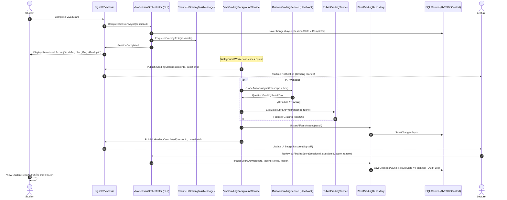

# AIVES Group Project — Shared Architecture & Integration Contracts
## Functional Group 4: AI-Assisted Viva Exam Grading (Human-In-The-Loop)

> **Status:** Official Approved Specification (Group Project — Assignment 3)  
> **Author:** Tech Lead & Architecture Reviewer (`TuongHiuKin`)  
> **Target Audience:** All 5 Team Members (Tech Lead, Database, AI Integration, Background & Realtime, Frontend Razor Pages)  
> **Applicable Stack:** ASP.NET Core .NET 8, Razor Pages, SignalR Realtime, EF Core, SQL Server, 3-Layer Architecture (Presentation → BLL → DAL)  
> **Referenced Issue:** #1 (`[G4-LEAD-01]`)

---

## 1. Executive Summary & Core Workflow

Functional Group 4 introduces **AI-Assisted Grading with Human-in-the-Loop (HITL)** for the AIVES Viva Examination system.
The system automatically assesses student verbal performance per question using rubric criteria and AI LLM models while ensuring university instructors retain complete final authority over all recorded grades.

### 1.1 Locked Business Decisions (Quyết định nghiệp vụ đã chốt)

1. **Student Instant Feedback with Pending Badge:**
   - Immediately after completing a viva interview, students can view their AI provisional score labeled:
     `"AI chấm, chờ giảng viên duyệt"` (Orange/Warning badge).
   - Once an instructor finalizes or overrides the score, the label transitions to:
     `"Điểm chính thức"` (Green/Success badge).
2. **Instructor Review & Decision (Human-in-the-Loop):**
   - **Xác nhận điểm AI (Accept AI Score):** 1-click action setting `TeacherFinalScore = AiScore`, marking the question `Finalized`.
   - **Nhập điểm GV (Teacher Override):** Instructor inputs a custom score (validated within `[0, MaxPoints]`) and optional feedback notes, marking the question `Finalized`.
3. **Audit Trail for Post-Finalization Edits:**
   - A finalized score may still be modified by authorized instructors, but **requires a mandatory non-empty reason** (`Reason`).
   - Every confirmation or revision creates an immutable audit record in `VivaGradeChangeLogs`.
4. **Database-Seeded Question Rubrics:**
   - Sample rubrics for exam questions (e.g., `EXAM01` Q1, Q2, Q3) reside in SQL Server (`VivaRubricCriteria`) and are seeded via idempotent SQL scripts, replacing the legacy hardcoded `RubricCatalog`.
   - Rubric management UI belongs to Group 1 (out of scope for Group 4).
5. **Per-Question Isolated Grading & Fallback:**
   - AI evaluates each question independently in separate LLM calls. A timeout or failure on one question does **not** corrupt or block others.
   - If AI fails or is unavailable, the system automatically falls back to `RubricGradingService` (keyword-based rubric evaluation).

---

## 2. End-to-End Workflow Diagram



---

## 3. Data Contracts & Enums

### 3.1 Namespace Conventions
- Domain Entities: `AIVES.DAL.Entities`
- Repository Interfaces: `AIVES.DAL.Repositories.Interfaces`
- BLL Service Interfaces: `AIVES.BLL.Interfaces.Grading` & `AIVES.BLL.Interfaces.Ai`
- DTOs & Models: `AIVES.BLL.Models.Grading`

### 3.2 State Machine: `GradingState`
```csharp
namespace AIVES.BLL.Models.Grading;

public enum GradingState : byte
{
    Pending = 0,    // Queued or awaiting grading
    AiGraded = 1,   // Graded by AI/fallback, awaiting instructor review
    Finalized = 2,  // Confirmed or overridden by teacher (Official)
    Failed = 3      // AI evaluation failed and pending manual review/regrade
}
```

> **Hai enum `GradingState` — không nhầm lẫn.** Nhóm 4 dùng enum trên (giá trị byte lưu trong
> `VivaGradingResult.GradingState`). Nhóm 6 (báo cáo) có enum riêng tên `ReportGradingState`
> trong `AIVES.BLL.Models.ExamReporting` (`Pending = 1`, `Graded = 2`, `Failed = 3` — giá trị
> của DTO báo cáo, **không** ghi xuống DB). Mapping do `ExamReportRepository` thực hiện:

| `GradingState` (Nhóm 4, DB) | `ReportGradingState` (Nhóm 6, DTO) | Nhãn hiển thị |
|---|---|---|
| `Pending` (0) | `Pending` (1) | "Đang chờ chấm" |
| `AiGraded` (1) | `Graded` (2) | "AI chấm, chờ giảng viên duyệt" |
| `Finalized` (2) | `Graded` (2) | "Điểm chính thức" |
| `Failed` (3) | `Failed` (3) | "Chấm lỗi" |

> **Báo cáo không tự chấm.** `ExamReportRepository` chỉ đọc `VivaGradingResult` đã lưu. Phiên đã
> `Completed` mà chưa có bản ghi chấm ⇒ `ReportGradingState.Pending`, `EarnedScore = 0`. Việc chấm
> là của `GradingOrchestrator` chạy nền; nếu báo cáo tự gọi `RubricGradingService` thì sinh viên sẽ
> thấy điểm khác điểm AI thật và giảng viên không có gì để duyệt.

> **`RubricCatalog` là fallback.** `AIVES.BLL/Services/ExamReporting/RubricCatalog.cs` chỉ dùng khi
> bảng `VivaRubricCriteria` chưa được seed (môi trường chưa chạy script `006`); khi fallback được
> dùng, service ghi `LogWarning`. Nguồn chuẩn là DB qua `IVivaRubricRepository`.

### 3.3 Core DTOs
```csharp
namespace AIVES.BLL.Models.Grading;

public sealed class CriterionOutcomeDto
{
    public string CriterionCode { get; set; } = string.Empty;
    public string CriterionName { get; set; } = string.Empty;
    public decimal MaxPoints { get; set; }
    public decimal AwardedPoints { get; set; }
    public bool IsMet { get; set; }
    public string Explanation { get; set; } = string.Empty;
}

public sealed class SpeechMetricsDto
{
    public double AnswerDurationSeconds { get; set; }
    public double SpeakingSpeedWpm { get; set; }
    public int FillerWordsCount { get; set; }
    public double FillerWordsRatio { get; set; }
    public List<string> IdentifiedFillerWords { get; set; } = new();
}

public sealed class QuestionGradingResultDto
{
    public Guid Id { get; set; }
    public Guid SessionId { get; set; }
    public string QuestionId { get; set; } = string.Empty;
    public string QuestionTitle { get; set; } = string.Empty;
    public string? BloomLevel { get; set; }
    public decimal MaxPoints { get; set; } = 10m;

    // AI Assessment
    public decimal? AiScore { get; set; }
    public string? AiFeedback { get; set; }
    public string? Strengths { get; set; }
    public string? Weaknesses { get; set; }
    public List<CriterionOutcomeDto> CriteriaOutcomes { get; set; } = new();
    public string? AiProvider { get; set; }
    public string? AiModel { get; set; }
    public GradingState State { get; set; } = GradingState.Pending;

    // Supplementary Signal
    public SpeechMetricsDto? SpeechMetrics { get; set; }

    // Teacher Finalization
    public decimal? TeacherFinalScore { get; set; }
    public string? TeacherNotes { get; set; }
    public string? FinalizedBy { get; set; }
    public DateTime? FinalizedAtUtc { get; set; }

    // Concurrency Token (Base64)
    public string? RowVersion { get; set; }

    // Calculated Property for Effective Score
    public decimal? EffectiveScore => TeacherFinalScore ?? AiScore;
    public bool IsFinalized => State == GradingState.Finalized;
}

public sealed class SessionGradingSummaryDto
{
    public Guid SessionId { get; set; }
    public string ExamId { get; set; } = string.Empty;
    public string StudentId { get; set; } = string.Empty;
    public string StudentName { get; set; } = string.Empty;
    public DateTime SessionCompletedAtUtc { get; set; }

    public decimal TotalMaxScore { get; set; }
    public decimal? TotalAiScore { get; set; }
    public decimal? TotalFinalScore { get; set; }
    public decimal? EffectiveTotalScore => TotalFinalScore ?? TotalAiScore;

    public GradingState OverallState { get; set; }
    public bool IsFullyFinalized { get; set; }
    public List<QuestionGradingResultDto> QuestionResults { get; set; } = new();
}

public sealed class FinalizeScoreRequestDto
{
    public Guid SessionId { get; set; }
    public string QuestionId { get; set; } = string.Empty;
    public decimal FinalScore { get; set; }
    public string? TeacherNotes { get; set; }
    public string? ChangeReason { get; set; }
    public string? ExpectedRowVersion { get; set; }
}

public sealed class GradeChangeLogDto
{
    public long Id { get; set; }
    public Guid GradingResultId { get; set; }
    public decimal? OldScore { get; set; }
    public decimal NewScore { get; set; }
    public string ChangedBy { get; set; } = string.Empty;
    public string Reason { get; set; } = string.Empty;
    public DateTime ChangedAtUtc { get; set; }
}

public sealed class GradingInputDto
{
    public Guid SessionId { get; set; }
    public string QuestionId { get; set; } = string.Empty;
    public string QuestionText { get; set; } = string.Empty;
    public string? BloomLevel { get; set; }
    public decimal MaxPoints { get; set; } = 10m;
    public string StudentAnswerTranscript { get; set; } = string.Empty;
    public List<string> FollowUpTurns { get; set; } = new();
    public List<RubricCriterionDto> RubricCriteria { get; set; } = new();
}

public sealed class RubricCriterionDto
{
    public string CriterionCode { get; set; } = string.Empty;
    public string CriterionName { get; set; } = string.Empty;
    public decimal MaxPoints { get; set; }
    public decimal Weight { get; set; } = 1.0m;
    public string? Description { get; set; }
    public List<string> Keywords { get; set; } = new();
}
```

---

## 4. Service Interfaces

### 4.1 AI Integration: `IAnswerGradingService`
```csharp
namespace AIVES.BLL.Interfaces.Ai;

public interface IAnswerGradingService
{
    Task<QuestionGradingResultDto> GradeAnswerAsync(
        GradingInputDto input, 
        CancellationToken ct = default);
}
```

### 4.2 BLL Orchestrator: `IGradingOrchestrator`
```csharp
namespace AIVES.BLL.Interfaces.Grading;

public interface IGradingOrchestrator
{
    Task<SessionGradingSummaryDto> GradeSessionAsync(
        Guid sessionId, 
        CancellationToken ct = default);

    Task<QuestionGradingResultDto> GradeQuestionAsync(
        Guid sessionId, 
        string questionId, 
        CancellationToken ct = default);

    Task<QuestionGradingResultDto> RegradeQuestionAsync(
        Guid sessionId, 
        string questionId, 
        string requestedBy, 
        CancellationToken ct = default);

    Task<QuestionGradingResultDto> FinalizeScoreAsync(
        FinalizeScoreRequestDto request, 
        string teacherId, 
        CancellationToken ct = default);

    Task<SessionGradingSummaryDto?> GetSessionGradingAsync(
        Guid sessionId, 
        CancellationToken ct = default);

    Task<List<SessionGradingSummaryDto>> GetGradingListByExamAsync(
        string examId, 
        string? classId = null, 
        GradingState? filterState = null, 
        CancellationToken ct = default);
}
```

### 4.3 DAL Repositories: `IVivaGradingRepository` & `IVivaRubricRepository`
```csharp
namespace AIVES.DAL.Repositories.Interfaces;

public interface IVivaGradingRepository
{
    Task<List<VivaGradingResult>> GetBySessionIdAsync(Guid sessionId, CancellationToken ct = default);
    Task<VivaGradingResult?> GetByQuestionAsync(Guid sessionId, string questionId, CancellationToken ct = default);
    Task<List<VivaGradingResult>> GetByExamIdAsync(string examId, CancellationToken ct = default);
    Task<List<Guid>> GetPendingOrFailedSessionIdsAsync(int limit = 50, CancellationToken ct = default);

    Task<VivaGradingResult> UpsertAiResultAsync(VivaGradingResult result, CancellationToken ct = default);
    Task<VivaGradingResult> FinalizeScoreAsync(
        Guid sessionId, 
        string questionId, 
        decimal finalScore, 
        string teacherNotes, 
        string teacherId, 
        byte[]? expectedRowVersion, 
        string? changeReason, 
        CancellationToken ct = default);

    Task<List<VivaGradeChangeLog>> GetChangeLogsAsync(Guid gradingResultId, CancellationToken ct = default);
}

public interface IVivaRubricRepository
{
    Task<List<VivaRubricCriterion>> GetCriteriaByQuestionAsync(string questionId, CancellationToken ct = default);
    Task<List<VivaRubricCriterion>> GetCriteriaByExamAsync(string examId, CancellationToken ct = default);
}
```

---

## 5. SignalR Realtime Contracts

### 5.1 Hub Endpoint & Authorization
- **Hub Route:** `/hubs/viva`
- **Authorized Group Name:** `grading-{examId}` (e.g. `grading-EXAM01`)
- **Group Security:** Only users with `ClaimTypes.Role == ApplicationRoles.Lecturer` or `ApplicationRoles.Admin` are permitted to join. Unauthorized attempts are rejected.

### 5.2 Realtime Events (`IVivaRealtimePublisher`)

| Event Name | Direction | Group | Payload | Purpose |
| :--- | :--- | :--- | :--- | :--- |
| `GradingStarted` | Server → Client | `grading-{examId}` | `{ Guid SessionId, string QuestionId, DateTime StartedAtUtc }` | Notify instructors that AI evaluation for a question has started. |
| `GradingCompleted` | Server → Client | `grading-{examId}` | `{ Guid SessionId, string QuestionId, byte State, decimal EarnedScore, decimal MaxScore, bool IsAiGraded }` | AI grading finished and persisted. Updates live status badge on web page. |
| `GradingFailed` | Server → Client | `grading-{examId}` | `{ Guid SessionId, string QuestionId, string ErrorMessage, bool FallbackTriggered }` | Alert instructors of grading error / fallback activation. |

---

## 6. Architecture & Security Boundaries

1. **3-Layer Separation of Concerns:**
   - **Presentation (`StudentNameMVC`):** Razor Pages (`/Grading/Index`, `/Grading/Review`) and `VivaHub` interact **exclusively** with BLL interfaces (`IGradingOrchestrator`, `IStudentReportService`). Direct references to `AIVESDbContext` or repositories are strictly forbidden.
   - **Business Logic Layer (`AIVES.BLL`):** Implements orchestrators, prompt formatting, validation, speech metrics, and fallback policies.
   - **Data Access Layer (`AIVES.DAL`):** Manages entity mappings, database transactions, concurrency tokens, and change logs.
2. **Scoped Lifetimes:**
   - All repositories (`IVivaGradingRepository`, `IVivaRubricRepository`) and `AIVESDbContext` are registered as **Scoped**.
3. **Persistence First Rule:**
   - State and evaluation results must be committed to SQL Server via `await _dbContext.SaveChangesAsync()` before broadcasting any realtime event over SignalR.
4. **Optimistic Concurrency Control:**
   - `VivaGradingResult` includes a `RowVersion` byte array. If two lecturers attempt to finalize or override the same question simultaneously, a concurrency exception (`DbUpdateConcurrencyException`) is caught and reported to the client with a clear reload prompt.

---

## 7. Reporting & UI Status Badge Alignment

| Assessment Condition | Display Badge | Color Class | Visible To Student |
| :--- | :--- | :--- | :--- |
| Turn completed, AI evaluating or queued | `Chờ chấm điểm` | `badge bg-secondary` | Yes |
| AI evaluated, pending teacher review | `AI chấm, chờ giảng viên duyệt` | `badge bg-warning text-dark` | Yes |
| Instructor accepted AI score or overrode score | `Điểm chính thức` | `badge bg-success` | Yes |
| AI evaluation failed (no fallback yet) | `Cần chấm lại` | `badge bg-danger` | Instructor only |

When calculating class averages and report analytics in `ExamReportRepository` and `StudentReportService`:
$$\text{EarnedScore} = \text{TeacherFinalScore} \;\;(\text{if present}) \;\lor\; \text{AiScore} \;\;(\text{if present}) \;\lor\; 0$$
Attempt status is considered `Graded` once either `TeacherFinalScore` or `AiScore` is non-null.

---

## 8. Sign-off & Verification Checklist

- [x] All 5 team members have clear module responsibilities aligned with this contract.
- [x] Zero direct DB access from Razor Pages and SignalR Hubs enforced.
- [x] Locked business decisions (AI provisional badge, instructor override, audit log, DB rubrics) explicitly documented.
- [x] Ready to serve as the baseline for `LEAD-02` through `LEAD-05` and team implementations.
