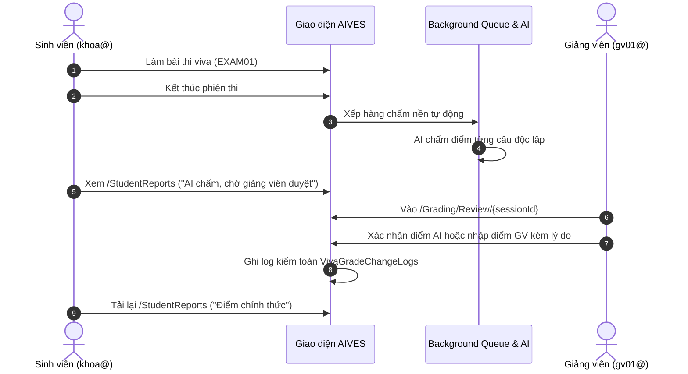

# Kịch bản Demo: Hệ thống AI Hỗ trợ Chấm điểm Thi Vấn đáp (AIVES - Group 4)

Tài liệu này hướng dẫn chi tiết quy trình kiểm thử và demo đồ án **Group 4 — AI-Assisted Viva Exam Grading with Human-in-the-Loop (HITL)** trong hệ thống thi vấn đáp trực tuyến **AIVES**.

---

## 1. Chuẩn bị & Cấu hình môi trường

Hệ thống hỗ trợ 2 chế độ vận hành độc lập: **Chế độ Mock AI (Khuyên dùng khi demo nhanh/offline)** và **Chế độ Real AI (Gemini / OpenAI)**.

### 1.1. Chế độ Mock AI (Offline, Không tốn phí API)
- Trong tệp `StudentNameMVC/appsettings.json` hoặc cấu hình mặc định:
  ```json
  "AiServices": {
    "UseMock": true,
    "AllowMockFallback": true
  }
  ```
- Hệ thống tự động sử dụng `MockAnswerGradingService` kết hợp `RubricGradingService` từ khóa: chấm điểm tức thì, tạo rubric outcomes và nhận xét chi tiết mà không cần gọi API ra ngoài internet.

### 1.2. Chế độ Real AI (Gemini / OpenAI / DeepSeek)
1. Đăng nhập tài khoản Admin mặc định:
   - **URL:** `/Account/Login`
   - **Email:** `admin@AIVESSystem.org` (hoặc email cấu hình trong `DefaultAdmin:Email`)
   - **Mật khẩu:** Theo cấu hình trong `appsettings.json`
2. Truy cập `/Admin/AiSettings`:
   - **DeepSeek (nhanh nhất):** dùng khối **"Kết nối DeepSeek"**, dán API key rồi bấm
     **Kết nối DeepSeek**. Hệ thống tự tạo hồ sơ, định tuyến LLM + Grading và bật AI thật.
     Chi tiết: [ai-deepseek-setup.md](ai-deepseek-setup.md).
   - **Gemini / OpenAI:** bấm **Thêm nhà cung cấp**, chọn Kind tương ứng, nhập API Key,
     bấm **Kiểm tra kết nối**, rồi cấu hình **Routing** cho năng lực chấm điểm (**Grading**).
   - Bật cờ **Sử dụng AI thật (UseRealAi)** và lưu cấu hình.

> **Lưu ý:** DeepSeek không có STT/TTS. Nếu demo cần đọc câu hỏi bằng giọng nói,
> bật `AiServices:UseBrowserSpeechSynthesis = true` (trình duyệt tự đọc) hoặc cấu hình
> STT/TTS sang Gemini/OpenAI song song.

---

## 2. Danh sách Tài khoản Demo

> Các tài khoản dưới đây được tạo bởi `MockExamDataSeeder` khi `MockData:SeedOnStartup = true`
> (mặc định trong `appsettings.Development.json`). Mật khẩu dùng chung là **`Test@123`**.
> Nếu DB đã có tài khoản cùng email, seeder bỏ qua (idempotent) và giữ mật khẩu hiện tại.

| Vai trò | Email đăng nhập | Mật khẩu mặc định | Mục đích sử dụng trong Demo |
| :--- | :--- | :--- | :--- |
| **Admin** | `admin@AIVESSystem.org` | `@@abc123@@` (xem `DefaultAdmin` trong `appsettings.json`) | Cấu hình AI Provider và hệ thống |
| **Giảng viên (Lecturer)** | `gv01@aives.local` | `Test@123` | Review bài thi, chốt điểm AI, override điểm, xem báo cáo lớp |
| **Sinh viên (Student)** | `sv.test1@aives.local` | `Test@123` | Sinh viên sạch để thi thử trực tiếp (`/Viva/Index`) |
| **Sinh viên (có bài sẵn)** | `minhanh@mock.aives.local` (và 5 tài khoản `@mock.aives.local` khác) | `Test@123` | Xem báo cáo cá nhân với lượt thi EXAM01 đã hoàn thành |

Ghi chú: role trong DB chỉ có 2 giá trị — `1` = Staff/Sinh viên, `2` = Lecturer.
`admin@AIVESSystem.org` là tài khoản Admin cấu hình trong `DefaultAdmin` (không nằm trong bảng `SystemAccount`).

---

## 3. Kịch bản Demo từng bước (Step-by-Step Walkthrough)



### Bước 1: Sinh viên thực hiện bài thi viva
1. Đăng nhập với tài khoản sinh viên sạch `sv.test1@aives.local` (mật khẩu `Test@123`).
2. Truy cập trang `/Viva/Index` và chọn đề thi **EXAM01** (.NET Core & Kiến trúc Ba lớp).
3. Bấm **Bắt đầu thi vấn đáp** (`/Viva/Exam/{sessionId}`).
4. Trả lời các câu hỏi bằng giọng nói (hoặc microphone giả lập):
   - **Câu 1 (EXAM01-Q01):** *"DbContext trong ASP.NET Core phải được đăng ký Scoped vì mỗi HTTP request cần một instance độc lập. Nếu đăng ký Singleton thì ChangeTracker sẽ giữ entity gây rò rỉ bộ nhớ và DbContext không thread-safe."*
   - **Câu hỏi xoáy AI (Turn 2):** Trả lời câu hỏi làm rõ của AI.
   - **Câu 2 (EXAM01-Q02):** *"Repository pattern trừu tượng hóa truy vấn EF Core khỏi BLL, giúp tuân thủ Dependency Inversion và dễ dàng viết unit test với Mock."*
5. Bấm **Nộp bài và hoàn thành**.

### Bước 2: AI chấm điểm nền tự động
- Phiên thi chuyển trạng thái `Completed`.
- Hàng đợi nền `System.Threading.Channels` (`VivaGradingBackgroundService`) nhận diện phiên thi mới và gọi `IGradingOrchestrator.GradeSessionAsync`.
- AI chấm điểm độc lập từng câu hỏi:
  - Phân tích transcript câu trả lời ban đầu và câu hỏi xoáy.
  - Đối chiếu với các tiêu chí rubric trong database (`VivaRubricCriteria`).
  - Lưu kết quả vào bảng `VivaGradingResults` với trạng thái `AiGraded` (1).
- Nếu AI provider gặp lỗi (hết quota, timeout), hệ thống tự động kích hoạt **Keyword Fallback** (`RubricGradingService`) mà không làm gián đoạn bài thi.

### Bước 3: Sinh viên xem điểm gợi ý tức thì
1. Sinh viên truy cập ngay trang **Báo cáo cá nhân** tại `/StudentReports`.
2. Kiểm tra giao diện kết quả:
   - Tổng điểm và từng câu hỏi hiển thị điểm số do AI gợi ý.
   - Nhãn trạng thái rõ ràng: <span class="badge bg-warning text-dark">AI chấm, chờ giảng viên duyệt</span>.
   - Xem chi tiết phản hồi của AI: các tiêu chí đạt/chưa đạt, nhận xét điểm mạnh và điểm cần cải thiện.

### Bước 4: Giảng viên Review và Chốt điểm (HITL)
1. Đăng xuất sinh viên, đăng nhập tài khoản Giảng viên `gv01@aives.local`.
2. Trên thanh điều hướng, chọn **Chấm điểm thi** (`/Grading/Index`).
3. Danh sách hiển thị bài thi vừa nộp với trạng thái <span class="badge bg-warning text-dark">Chờ duyệt</span>.
4. Bấm **Xem chi tiết** để vào trang `/Grading/Review/{sessionId}`:
   - **Xem lại dữ liệu:** Đọc toàn bộ transcript hội thoại, câu hỏi xoáy của AI và câu trả lời của sinh viên.
   - **Phân tích AI:** Xem chi tiết điểm từng tiêu chí rubric, nhận xét điểm mạnh, điểm yếu.
   - **Tín hiệu phụ:** Xem thời gian trả lời và tốc độ nói (từ/phút).
5. **Thao tác 1 — Xác nhận điểm AI (Accept AI Score):**
   - Với **Câu 1**: Bấm nút **"Xác nhận điểm AI"**.
   - Hệ thống tự động gán điểm chính thức bằng đúng điểm AI gợi ý.
   - Nhãn đổi sang <span class="badge bg-success text-white">Điểm chính thức</span>.
6. **Thao tác 2 — Can thiệp / Nhập điểm GV (Teacher Override):**
   - Với **Câu 2**: Giảng viên muốn cho điểm thưởng vì sinh viên trả lời xuất sắc câu hỏi xoáy.
   - Chọn **"Nhập điểm GV"** -> Điền điểm mới: `9.5` / `10`.
   - Nhập ghi chú: *"Phân tích rất sâu về DIP và Clean Architecture."*
   - Nhập lý do thay đổi (bắt buộc): *"Cộng 1.5 điểm vì câu trả lời hỏi xoáy vượt mong đợi."*
   - Bấm **Lưu điểm chốt**.
   - Hệ thống tự động ghi lại 1 dòng kiểm toán trong `VivaGradeChangeLogs`.

### Bước 5: Kiểm tra Lịch sử thay đổi (Audit Log)
- Tại trang review, bấm xem tab **Lịch sử sửa điểm (Audit Trail)**.
- Bảng hiển thị rõ:
  - Thời gian sửa (UTC & Giờ địa phương).
  - Người thực hiện (`gv01@aives.local`).
  - Điểm cũ -> Điểm mới (`8.0` -> `9.5`).
  - Lý do điều chỉnh: *"Cộng 1.5 điểm vì câu trả lời hỏi xoáy vượt mong đợi."*

### Bước 6: Sinh viên xem điểm chính thức
1. Đăng nhập lại tài khoản sinh viên vừa thi `sv.test1@aives.local`.
2. Vào `/StudentReports`:
   - Trạng thái bài thi cập nhật: <span class="badge bg-success text-white">Điểm chính thức</span>.
   - Câu 1: Điểm chính thức = Điểm AI (`10.0`).
   - Câu 2: Điểm chính thức = Điểm GV chốt (`9.5`), có hiển thị ghi chú của giảng viên.

### Bước 7: Giảng viên xem Báo cáo lớp và Xuất bảng điểm
1. Đăng nhập Giảng viên `gv01@aives.local` -> Truy cập `/ClassReports`.
2. Chọn đề thi **EXAM01**:
   - Biểu đồ phổ điểm và điểm trung bình lớp tự động tính toán dựa trên điểm chính thức vừa chốt.
   - Danh sách câu hỏi khó nhất (Hardest Questions) phản ánh chính xác kết quả chấm.
3. Bấm **Xuất bảng điểm** (`/ClassReports/ExportGradeSheet`) để tải file CSV/bảng điểm lớp.

---

## 4. Các tình huống kiểm thử đặc biệt (Edge Cases)

| Kịch bản kiểm thử | Hành động thực hiện | Kết quả kỳ vọng |
| :--- | :--- | :--- |
| **Fault Isolation khi AI lỗi** | Tắt mạng hoặc cấu hình API Key sai rồi kích hoạt chấm bài. | Dịch vụ bắt exception, tự động fallback sang `RubricGradingService` (chấm từ khóa). Không làm sập ứng dụng, bài thi vẫn có điểm với nhãn provider `"KeywordFallback"`. |
| **Bảo vệ điểm đã chốt** | Bấm nút "Chấm lại bằng AI" sau khi giảng viên đã chốt điểm câu hỏi. | AI chấm lại các câu chưa chốt, nhưng **tuyệt đối không ghi đè** câu hỏi đã ở trạng thái `Finalized`. |
| **Chống xung đột (Optimistic Concurrency)** | 2 giảng viên cùng mở trang review và cùng bấm chốt điểm cho 1 câu hỏi. | Giảng viên gửi sau nhận thông báo lỗi xung đột phiên bản (Concurrency Conflict), yêu cầu tải lại dữ liệu mới nhất. |
| **Bắt buộc nhập lý do khi sửa điểm đã chốt** | Sửa lại điểm của một câu đã có trạng thái `Finalized` nhưng để trống ô lý do. | Form validation chặn lại và hiển thị cảnh báo: *"Vui lòng nhập lý do điều chỉnh điểm."* |
